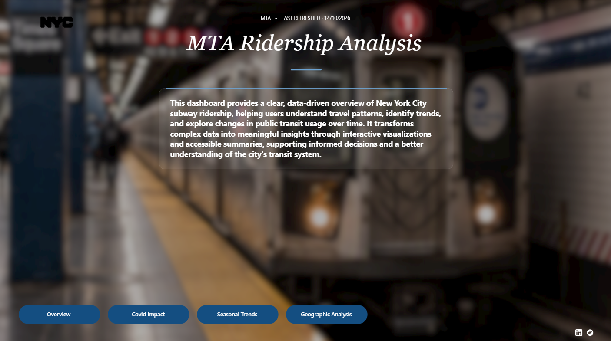
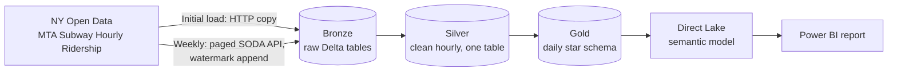
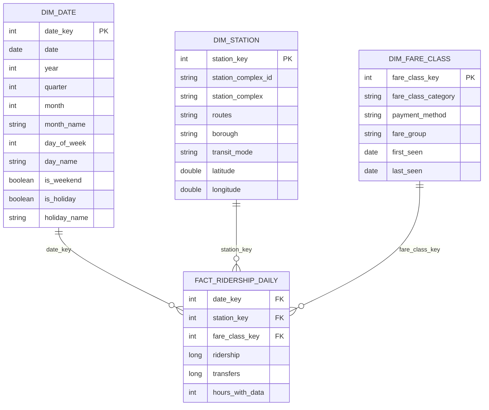
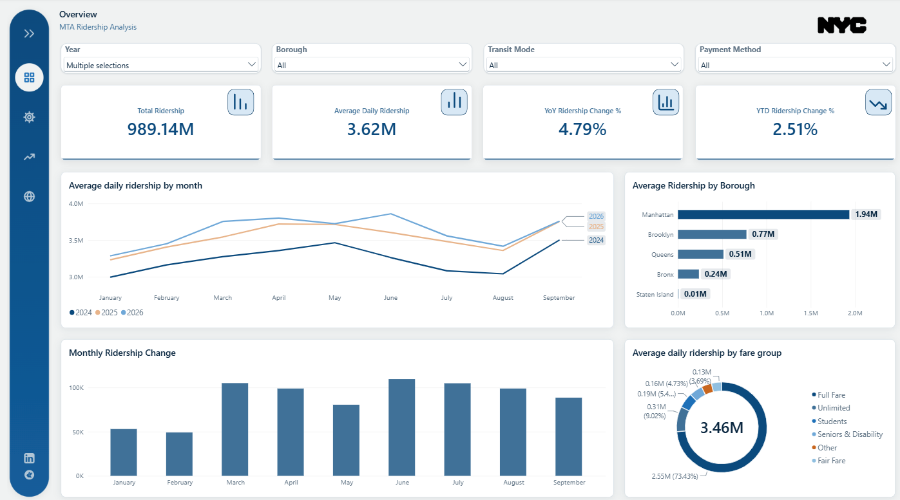
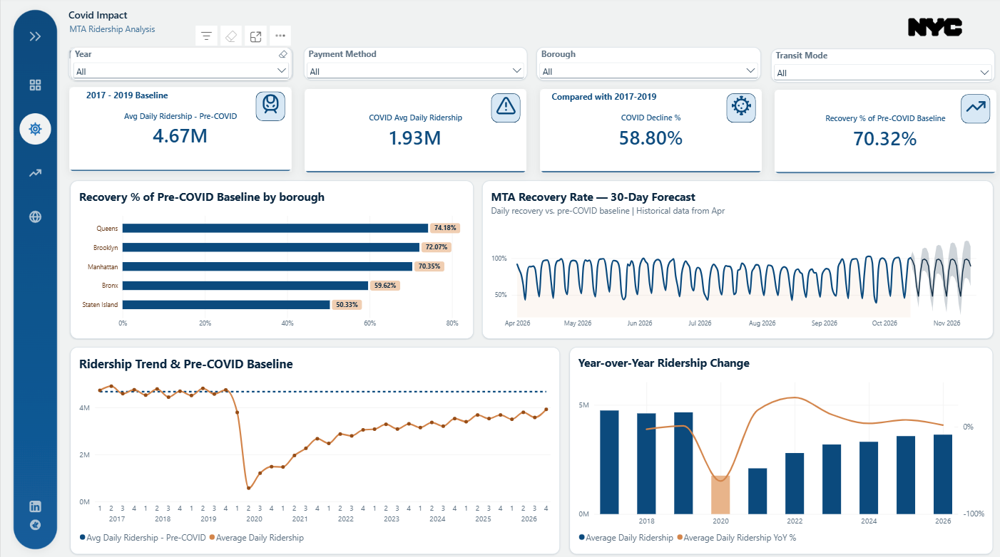
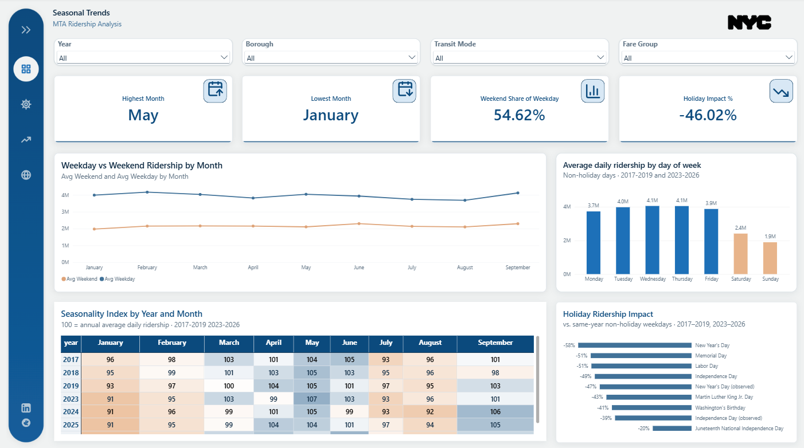
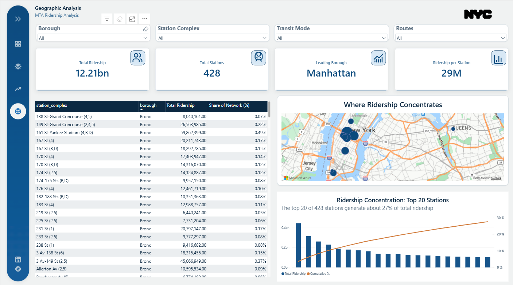
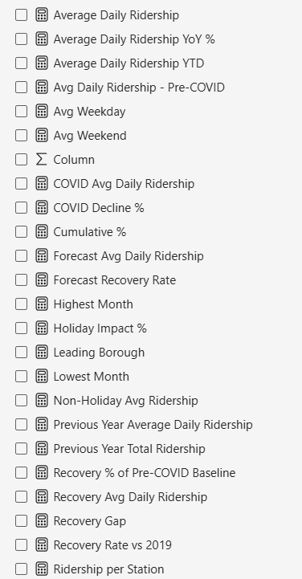
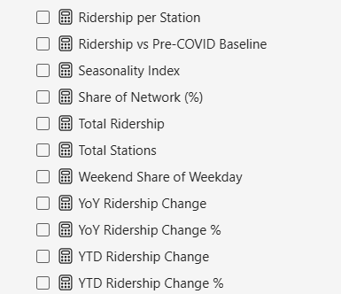

# MTA Subway Ridership Analytics

**An end-to-end data platform on Microsoft Fabric: automated ingestion of 224M+ hourly subway records, a medallion Lakehouse, a Direct Lake semantic model, and a four-page Power BI report.**

> **Data period:** 13 January 2017 to 14 October 2026 (latest refresh) &nbsp;|&nbsp; **Scale:** 224M+ hourly rows, 12.2 billion entries, 428 station complexes &nbsp;|&nbsp; **Platform:** Microsoft Fabric (Lakehouse, Pipelines, PySpark notebooks, Direct Lake, Power BI)

---

## Table of contents

1. [Project overview](#1-project-overview)
2. [Key findings](#2-key-findings)
3. [Data source](#3-data-source)
4. [Architecture](#4-architecture)
5. [ETL pipeline](#5-etl-pipeline)
6. [Data model](#6-data-model)
7. [Data quality and validation](#7-data-quality-and-validation)
8. [Semantic model and DAX measures](#8-semantic-model-and-dax-measures)
9. [Report pages](#9-report-pages)
10. [Operations and scheduling](#10-operations-and-scheduling)
11. [Engineering decisions and lessons learned](#11-engineering-decisions-and-lessons-learned)
12. [Tech stack](#12-tech-stack)
13. [Fabric items](#13-fabric-items)
14. [Limitations and roadmap](#14-limitations-and-roadmap)
15. [Author](#15-author)

---

## 1. Project overview

New York City's subway is the largest rapid transit system in North America. The MTA publishes entry counts at hourly grain, but the raw files are large (tens of gigabytes), split across datasets, and not ready for analysis. This project turns them into a governed, refreshable analytics product.

**What it delivers**

- **Automated ETL** that loads the full history once, then appends new data weekly, with row-count checks against the source before anything is written.
- **A medallion Lakehouse** (Bronze, Silver, Gold) in Delta format, reconciled layer to layer to the exact ridership total.
- **A dimensional model** at daily grain (date, station, fare class) served through a **Direct Lake** semantic model.
- **A Power BI report** covering the overall picture, the COVID impact and recovery, seasonal patterns, and geographic concentration.

**Business questions answered**

| Area | Question |
|---|---|
| Trend | How much ridership is there, and how is it changing year over year and year to date? |
| COVID impact | How far did ridership fall against the 2017-2019 baseline, and how much has recovered, by borough? |
| Seasonality | Which months and weekdays are busiest, how do holidays change demand? |
| Geography | Which stations and boroughs carry the network, and how concentrated is ridership? |

---

## 2. Key findings

| Theme | Finding |
|---|---|
| **Scale** | 12.21 billion entries across 428 station complexes, about 29M per station on average. |
| **COVID impact** | Average daily ridership fell **58.8%** from a pre-COVID baseline of **4.67M** (2017-2019) to **1.93M** during the COVID period. |
| **Recovery** | Ridership is at **70.32%** of the pre-COVID baseline. Queens (74.18%), Brooklyn (72.07%) and Manhattan (70.35%) lead; the Bronx (59.62%) and Staten Island (50.33%) lag. |
| **Concentration** | The top 20 of 428 stations generate about **27%** of all ridership. Manhattan is the leading borough. |
| **Seasonality** | May is the busiest month and January the quietest. Weekend ridership is about **55%** of weekday ridership. |
| **Holidays** | Holidays cut ridership by about **46%** against same-year non-holiday weekdays, with the largest dips on New Year's Day (-58%) and Memorial Day and Labor Day (-51%). |

*Figures are taken from the report as refreshed on 14 October 2026.*

---

## 3. Data source

**Publisher:** Metropolitan Transportation Authority (MTA), via [NY Open Data](https://data.ny.gov) (Socrata platform).
**Dataset family:** *MTA Subway Hourly Ridership*, published as three datasets.

| Dataset | Coverage | Dataset ID | Rows (at initial load) |
|---|---|---|---|
| 2017-2019 | 13 Jan 2017 to 31 Dec 2019 | `t69i-h2me` | 57,611,916 |
| 2020-2024 | 1 Jan 2020 to 31 Dec 2024 | `wujg-7c2s` | 120,855,567 |
| Beginning 2025 | 1 Jan 2025 onward (updated) | `5wq4-mkjj` | 45,962,558 (to 30 Sep 2026) |

**Grain:** one row per hour x station complex x payment method (OMNY or MetroCard) x fare class category.

**Columns:** `transit_timestamp`, `transit_mode` (subway, Staten Island Railway, Roosevelt Island Tram), `station_complex_id`, `station_complex`, `borough`, `payment_method`, `fare_class_category`, `ridership`, `transfers`, `latitude`, `longitude`, `Georeference`.

**Source characteristics that shaped the design**

- **Entries only.** Ridership counts turnstile entries by swipe or tap. It does not capture exits or origin-destination trips.
- **`transfers` is a subset of `ridership`.** The two must never be added together; the model reports transfers as a share.
- **Revisions.** The publisher states that data is revised for late-arriving transactions, so a pure append can drift slightly from the source. The pipeline measures that drift on every run (see [section 7](#7-data-quality-and-validation)).
- **Fare classes evolve.** There are 12 categories (7 MetroCard and 5 OMNY) that appear and fade over time, so the fare-class dimension carries first-seen and last-seen dates.
- **Stations are renamed.** The station name embeds the route letters, so it changes when service changes. `station_complex_id` is the stable key.

---

## 4. Architecture

| Layer | Contents | Grain | Role |
|---|---|---|---|
| **Bronze** | `bronze.mta_hourly_2017_2019`, `bronze.mta_hourly_2020_2024`, `bronze.mta_hourly_2025` | Hour | Raw data exactly as received, as strings, with `source_dataset` and `load_date` for lineage. |
| **Silver** | `silver.ridership_hourly` | Hour | Typed, standardized, validated, partitioned by year. A single trusted table. |
| **Gold** | `fact_ridership_daily`, `dim_date`, `dim_station`, `dim_fare_class` | Day | Dimensional model for reporting. |

All layers live in one Fabric Lakehouse with schemas (`bronze`, `silver`, `gold`). Storage is Delta/Parquet: the full raw history of roughly 33 GB of CSV occupies about 2 GB in Bronze.

---

## 5. ETL pipeline

### 5.1 Historical load into Bronze

- A Fabric **Data pipeline** with a parameterized **Copy activity** (`dataset_id`, `table_name`) moved each dataset from the NY Open Data CSV export **directly into Lakehouse Delta tables**: source to destination in the cloud, with no local download or upload.
- All columns land as strings and two lineage columns are stamped during the copy: `source_dataset` (the dataset ID) and `load_date` (UTC load time).
- Every load was validated against the portal's own row count before use.

| Dataset | Rows loaded | CSV read | Copy time |
|---|---|---|---|
| 2025 onward | 45,962,558 | 6.5 GB | 31 min |
| 2017-2019 | 57,611,916 | 8.6 GB | 78 min |
| 2020-2024 | 120,855,567 | 17.7 GB | 4 h 20 min |

### 5.2 Silver: clean and conform

`silver.ridership_hourly` unions the three Bronze tables (224,430,041 rows) and applies the same transformation to all of them:

- Parses the timestamp (`MM/dd/yyyy hh:mm:ss a`) into a true timestamp and derives `ridership_date`, `ridership_year` and `hour_of_day`.
- Standardizes categories: transit mode labels, payment method (`OMNY`, `MetroCard`), and the `MetroCard` spelling in fare classes.
- Casts `ridership` and `transfers` to integers and coordinates to doubles; drops the redundant `Georeference` column.
- Partitions by year.
- **Reconciliation:** row count and total ridership match Bronze exactly, with no duplicate keys on (timestamp, station, payment method, fare class).

### 5.3 Gold: daily dimensional model

- **`fact_ridership_daily`**: hourly rows aggregated to day x station x fare class (about 12M rows). Also stores `hours_with_data` to separate a quiet day from missing data.
- **`dim_station`**: one row per station complex, taking the latest name, borough, mode and coordinates (the source reports several coordinate variants for large complexes; they differ by at most a few hundred metres).
- **`dim_fare_class`**: the 12 fare classes with payment method, fare group, and first/last dates seen.
- **`dim_date`**: a continuous calendar from 2017 to 2026 with US federal holiday flags.
- **Stable surrogate keys:** new stations or fare classes receive the next key; existing keys never change. This matters because the semantic model assumes referential integrity.

### 5.4 Incremental weekly load (current design)

The load is a **watermark append through the paged SODA API**, run by a single PySpark notebook:

1. Read the latest loaded timestamp from Bronze.
2. Ask the source how many rows are newer, then pull exactly those rows in pages of 50,000 (the API's page limit) with a stable sort order and retries.
3. Normalize timestamps to the Bronze format, write to a staging table, and **assert the staged count equals the source count** before touching Bronze.
4. Append to Bronze, then append to Silver only the rows newer than Silver's last timestamp.
5. Update the dimensions with stable keys, then recompute the fact table from the last Gold day forward (a daily total cannot be appended, so the affected days are replaced).
6. Run the integrity checks. Any failure raises an error, which stops the pipeline before the semantic model refresh.

Every step derives its starting point from its own layer, so a failed run leaves the data consistent and a rerun **cannot create duplicates**.

---

## 6. Data model

**Design decisions**

- **Daily grain in Gold.** Hourly detail stays in Silver, so the report never carries 224M rows and the model stays small and fast.
- **Payment method lives in `dim_fare_class`.** Every fare class belongs to exactly one payment method, so it is an attribute, not a fact column.
- **Rows exist only where riders existed.** A missing station-day-fare-class row means zero entries.

---

## 7. Data quality and validation

An integrity notebook runs **over 30 automated checks** after every load and writes the results, with a timestamp, to `silver.dq_results`.

| Category | Checks |
|---|---|
| Keys and grain | Dimension keys unique; exactly one fact row per date x station x fare class |
| Referential integrity | No null keys or measures; no fact key without a matching dimension row |
| Calendar | Continuous date table, covers the fact's last date; month and day names map one-to-one to their sort columns |
| Measure sanity | Ridership above zero; hours reported between 1 and 24; transfers never exceed ridership |
| Reconciliation | Silver equals Gold for total ridership, total transfers, every year, and station count |
| Dimension quality | Coordinates inside the NYC area; five valid boroughs; unique station names (so the station hierarchy is safe); 12 fare classes |
| Append safety | No duplicate keys in Bronze or Silver; Bronze and Silver row counts equal; each layer is up to date with the one below |

**Informational checks:** rows with negative transfers, and **drift** (source rows up to the last loaded hour minus Bronze rows) to quantify how much of the source history has been revised since it was loaded. After the first append the drift was 11 rows out of about 46 million.

**Known source quirks (logged, not altered)**

- 250 hourly rows in 2026 OMNY data have small negative transfer counts (11 rows after daily aggregation).
- A handful of Staten Island rows carry the subway mode label.
- Large station complexes report several coordinate pairs; the model keeps the most recent dataset's most common one.

---

## 8. Semantic model and DAX measures

**Model:** a **Direct Lake** semantic model over the Gold Delta tables, with no import refresh and no SQL views. Query behaviour was checked with Performance Analyzer, which showed no DirectQuery fallback on the visuals tested.

**Configuration**

- Many-to-one relationships from each dimension to the fact, single filter direction, **Assume referential integrity** enabled (verified by the integrity notebook after every load; it also removes the virtual (Blank) member from slicers).
- `dim_date` marked as the date table; `month_name` sorted by `month` and `day_name` by `day_of_week`.
- Hierarchies: **Date** (year, quarter, month, day), **Station location** (borough, station), **Fare structure** (payment method, fare group, fare class).
- Key columns and raw numeric columns hidden; only explicit measures are exposed. Latitude and longitude carry map data categories.

**Measure catalogue (33 measures)**

| Category | Measures |
|---|---|
| Volume and averages | Total Ridership, Average Daily Ridership, Avg Weekday, Avg Weekend, Ridership per Station, Total Stations, Share of Network (%), Cumulative %, Leading Borough |
| Time intelligence | Previous Year Total Ridership, Previous Year Average Daily Ridership, YoY Ridership Change, YoY Ridership Change %, Average Daily Ridership YoY %, Average Daily Ridership YTD, YTD Ridership Change, YTD Ridership Change % |
| COVID and recovery | Avg Daily Ridership - Pre-COVID, COVID Avg Daily Ridership, COVID Decline %, Recovery Avg Daily Ridership, Recovery % of Pre-COVID Baseline, Recovery Gap, Recovery Rate vs 2019, Ridership vs Pre-COVID Baseline |
| Seasonality and holidays | Highest Month, Lowest Month, Seasonality Index, Weekend Share of Weekday, Holiday Impact %, Non-Holiday Avg Ridership |
| Forecast | Forecast Avg Daily Ridership, Forecast Recovery Rate |

**Access:** workspace roles plus Build permission on the semantic model let teammates connect from Power BI Desktop and build their own reports on the shared model.

---

## 9. Report pages

A custom-navigation Power BI report with a landing page and four analysis pages. Every page has its own slicers, and all KPIs recalculate with them.

### Landing page

Introduces the report, shows the **last refresh date** (14/10/2026), and links to the four pages.

### Overview

- **Slicers:** year, borough, transit mode, payment method.
- **KPIs:** Total Ridership, Average Daily Ridership, YoY Ridership Change %, YTD Ridership Change %.
- **Visuals:** average daily ridership by month (one line per year), average ridership by borough (Manhattan leads at 1.94M a day), monthly ridership change, and average daily ridership by fare group (Full Fare is about 73% of the total).

### Covid Impact

- **Slicers:** year, payment method, borough, transit mode.
- **KPIs:** pre-COVID baseline (4.67M a day, 2017-2019), COVID average (1.93M), COVID decline (58.80%), recovery (70.32% of baseline).
- **Visuals:** recovery by borough, a 30-day projection of the recovery rate with a confidence band, the ridership trend against the pre-COVID baseline by quarter, and year-over-year change.

### Seasonal Trends

- **Slicers:** year, borough, transit mode, fare group.
- **KPIs:** highest month (May), lowest month (January), weekend share of weekday (54.62%), holiday impact (-46.02%).
- **Visuals:** weekday against weekend ridership by month; average daily ridership by day of week on non-holiday days; a seasonality index heatmap by year and month (100 = that year's average); and holiday impact against same-year non-holiday weekdays.
- Seasonality views use **2017-2019 and 2023-2026**, deliberately leaving out the pandemic years that would distort seasonal patterns.

### Geographic Analysis

- **Slicers:** borough, station complex, transit mode, routes.
- **KPIs:** Total Ridership (12.21bn), Total Stations (428), Leading Borough (Manhattan), Ridership per Station (29M).
- **Visuals:** a station table with each station's share of the network, a map of where ridership concentrates, and a Pareto chart showing the top 20 of 428 stations generate about 27% of ridership.

### Measure list

| | |
|---|---|
|  |  |

---

## 10. Operations and scheduling

**Weekly pipeline:** one Notebook activity (extract, transform, load and integrity checks) followed by the **semantic model refresh**, joined by On-success dependencies and scheduled weekly. Because every step is idempotent, a retry is safe.

**Runbook**

| Symptom | Likely cause | Action |
|---|---|---|
| Integrity check fails | Data out of sync or a source change | Read the failing line in the notebook output, fix the cause, rerun |
| "Staged N rows but the source reports M" | The source published data mid-run | Rerun; nothing was appended |
| Semantic model refresh fails | Expired sign-in on the refresh connection | Re-authenticate the connection, then check the model's refresh history |
| Date table check fails near year end | `dim_date` ends on 31 Dec 2026 | Extend the calendar |
| Drift value grows week over week | The source is revising history | Add a rolling re-pull window (see roadmap) |

**Reproducing the project**

1. Create a Fabric Lakehouse with schemas enabled (`bronze`, `silver`, `gold`).
2. Load the three source datasets into Bronze with the parameterized Copy pipeline.
3. Build Silver, then the Gold dimensions and fact table, and run the integrity notebook.
4. Create the Direct Lake semantic model, relationships, hierarchies and measures; build the report.
5. Schedule the weekly load pipeline.

**Secrets:** the free Socrata app token is set in the notebook only and must not be committed to source control.

---

## 11. Engineering decisions and lessons learned

1. **A full-file overwrite load proved unreliable.** Three attempts to re-copy the 6 GB 2025 file each ended when the connection dropped mid-stream, at different points (about 29.8M, 26.6M and 42.1M rows), at only 0.3 to 0.7 MB/s. The Copy activity also empties its destination when it starts, so each failure left the Bronze table empty. It was recovered from **Delta version history** (the table's file-retention window had to be raised to read the old version). The load was redesigned as a **watermark append through the paged API** with a source row-count assertion, which makes failures cheap and reruns safe.
2. **Reconcile at every layer.** Row counts and total ridership are compared Bronze to Silver to Gold, and Gold to the report cards, so a silent loss cannot pass.
3. **Stable surrogate keys.** With referential integrity assumed in the model, keys must never shift when a new station appears, so new rows receive the next key and existing ones are untouched.
4. **Slicer blanks fixed deliberately.** Direct Lake models showed a phantom (Blank) member; enabling **Assume referential integrity** removed it, and the integrity notebook now guards the assumption.
5. **Plan for source behaviour.** The source's 50,000-row page limit, its revisions, and its renamed stations and fare classes each shaped a specific design choice above.

---

## 12. Tech stack

| Area | Tools |
|---|---|
| Platform | Microsoft Fabric: Lakehouse, Data Pipelines, Notebooks, Monitor hub |
| Storage and compute | Delta Lake, Apache Spark (PySpark), Spark SQL |
| Modelling and BI | Direct Lake semantic model, DAX, Power BI |
| Data access | Socrata SODA API (paged, with retries), HTTP connector |
| Languages and libraries | Python (pandas, requests, `holidays` for the calendar table), PySpark, SQL, DAX |
| Quality | PySpark integrity notebook writing to a Delta results table |

---

## 13. Fabric items

| Item | Type | Purpose |
|---|---|---|
| `mta_subway_lakehouse` | Lakehouse | Bronze, Silver and Gold schemas |
| `pl_mta_ingest` | Data pipeline | Historical full-file load and rebuilds |
| `pl_mta_weekly` | Data pipeline | Scheduled weekly load and model refresh |
| `nb_mta_append_load` | Notebook | Incremental extract, Silver, Gold and integrity checks |
| `sm_mta_ridership` | Semantic model | Direct Lake star schema with 33 measures |
| MTA Ridership Analysis | Power BI report | Landing page and four analysis pages |

---

## 14. Limitations and roadmap

**Limitations**

- **Entries only.** The data supports no origin-destination or exit analysis.
- **Revisions.** An append load does not correct history that the publisher later revises; drift is measured, not repaired.
- **Environment.** The project was built on a Fabric trial capacity, so the hosted items are time-limited; the code, results and screenshots here document the solution.

**Roadmap**

- Add a **rolling re-pull window** to absorb source revisions, and failure alerts on the pipeline.
- Add hourly **time-of-day views** (peak-hour profiles by station) using the Silver layer.
- Extend `dim_date` beyond 2026 as the data approaches the end of the calendar.

---

## 15. Authors

**Shaker Fayez** - Data / BI Analyst, Cairo, Egypt
[LinkedIn](https://www.linkedin.com/in/shakerfayez)

**Mohamed Ahmed** - Data Analyst 
[LinkedIn](https://www.linkedin.com/in/mohamed-othman24)

**Yasmine Shehata** - Data Analyst 
[LinkedIn](https://www.linkedin.com/in/yasmine-shehata)

**Esraa Mohamed** - Data Analyst 
[LinkedIn](https://www.linkedin.com/in/esraa-mohamed-87b127358)

**Data attribution:** MTA Subway Hourly Ridership, published by the Metropolitan Transportation Authority on [NY Open Data](https://data.ny.gov). This is an independent analysis and is not affiliated with or endorsed by the MTA.
